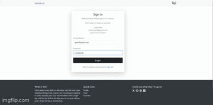

# TasteBook
A social platform where food lovers can share recipes, discover new dishes, and connect through their love of food.

**Link to project:** https://tastebook-g3xq.onrender.com/

    

**Tech used:** EJS, Bootstrap, MongoDB, Cloudinary

 

## How It's Made:

TasteBook is a full stack social application built using the MVC architecture. Users can create accounts, customize their profiles, share food posts, interact with other users through likes and comments, and browse a feed of community posts.

 

> Database Architecture

I used MongoDB and Mongoose to structure the application's data into three primary models: Users, Posts, and Comments.

Each model has its own schema defining the information it stores and how it relates to other documents.
* *Users*: Store usernames, email addresses, hashed passwords, bios, and profile pictures.
* *Posts*: Store titles, images, captions, creation dates, likes, and references to their creators.
* *Comments*: Store comment content, likes, creation dates, and references to both the post and user associated with them.

Using Mongoose ObjectIds allowed me to establish relationships between these collections. For example, posts reference their creators, while comments reference both their authors and the posts they belong to. This made retrieving related information throughout the application much easier.

 

>User Authentication and Authorization

I implemented user authentication using Passport.js, allowing users to register, log in, and maintain authenticated sessions. Passport handles the authentication process, while session management keeps users logged in as they navigate the application.

I also implemented authorization checks to ensure users can only modify content they're permitted to access.

For example, users can only delete their own posts, while comments can be deleted by either their creator or the owner of the post they belong to. Visiting another user's profile also removes editing privileges.

 

>Posts and Social Interactions

Users can create posts containing images, titles, and captions. Images are uploaded to Cloudinary, while the remaining post information is stored in MongoDB.

Posts support likes and comments, allowing users to interact with content from the community. I used an array of MongoDB ObjectIds to keep track of users who liked each post, making it possible to add or remove likes by updating that array.

The application also includes a personalized favorites page that retrieves posts liked by the current user.

 

>Dynamic Content and Views

I used EJS to render dynamic content based on the information retrieved from MongoDB.

The application includes reusable partials for shared elements such as the header and footer, as well as larger sections of the dashboard.

Conditional rendering is used throughout the application to determine what users can see and interact with depending on their current page and whether they own the content.

 

## Optimizations

There are several areas where I would like to improve the application:

* Refactor the dashboard views to reduce duplicated rendering logic.
* Implement a friendship system so users can connect and keep track of each other's posts.
* Allow users to see who liked their posts.
* Add the ability to like individual comments.
* Display the most liked comment directly within the main feed.

## Lessons Learned:

>Working with Mongoose and Data Relationships

I learned how to structure MongoDB documents using Mongoose schemas and establish relationships using ObjectIds. One particularly useful discovery was how easily arrays of ObjectIds could be used to track relationships, such as the users who liked a particular post.

 

>Retrieving Related Data with Populate

I learned how to use Mongoose's populate() method to retrieve related documents. This allowed me to retrieve information such as a post creator's username and profile picture without manually querying each user. I also became familiar with chaining methods such as find(), populate(), sort(), and lean() to retrieve and prepare data for rendering.

 

>Conditional Rendering with EJS

Throughout the application, I used EJS to conditionally render content based on the current user, page, and ownership of posts or comments. Working extensively with EJS's embedded JavaScript syntax strengthened my understanding of conditional logic and how server-side rendering works.

 

>Working with Cloudinary

I learned how to integrate Cloudinary for image uploads and deletion. One important detail was making sure that deleting a post also removed its associated image from Cloudinary, preventing unnecessary files from accumulating.

 

>Customizing Bootstrap Components

I learned how to work with Bootstrap's prebuilt components and customize them to better fit the application's design rather than relying entirely on their default appearance.

